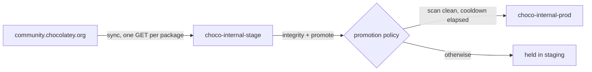

# choco-internalizer

[](https://github.com/lihongjie0209/choco-internalizer/actions/workflows/sync.yml)

Open-source Chocolatey package internalizer. It downloads installer resources,
embeds them in the `.nupkg`, rewrites supported Chocolatey helpers to local-file
helpers, and fails if external URLs remain.

The tool never executes scripts from the source package.

## Current support

- Local `.nupkg` input
- Static `$url` and `$url64bit` assignments
- PowerShell syntax-tree analysis through `tree-sitter-powershell`
- `Install-ChocolateyPackage` to `Install-ChocolateyInstallPackage`
- Download size limits
- ZIP path traversal and oversized-entry protection
- Residual external URL audit
- Pass-through verification for packages that already embed all resources

## Build and run

```bash
make test
make build
./bin/choco-internalizer internalize --input package.nupkg --output dist
```

Validate/internalize and publish in one command (already-internalized packages are
published too):

```bash
CHOCO_API_KEY=... ./bin/choco-internalizer internalize \
  --input package.nupkg \
  --output dist \
  --repository https://choco.lihongjie.cn
```

Upload the generated package:

```powershell
choco push .\dist\package.version.nupkg `
  --source https://choco.lihongjie.cn/api/v2/ `
  --api-key $env:CHOCO_API_KEY
```

Packages using computed URLs or unsupported download helpers fail closed and
must be handled by a future rule plugin or manually reviewed.

Recursively internalize dependencies and publish them before each parent package:

```bash
CHOCO_API_KEY=... ./bin/choco-internalizer sync 7zip git curl \
  --repository https://choco.lihongjie.cn
```

`packages.txt` is synchronized daily by an eight-way GitHub Actions matrix. A compatibility failure
is emitted as a workflow warning and recorded in the job summary, while the
remaining roots continue. Configure the repository secret `CHOCO_API_KEY`.

The destination repository performs idempotent `id + version` checks and keeps
only the three most recently published versions of every package, including
recursively resolved dependencies.

## This fork: Artifact Keeper, staging, and a promotion gate

Upstream publishes straight into its final repository. This fork publishes into
a **staging** repository and lets a gate decide what reaches **prod**, so a
package that is intact, scanned clean and old enough is the only thing clients
ever see.



* `.github/workflows/sync.yml` - mirrors the roots in `packages.txt` (and their
  dependency closure) into `choco-internal-stage`, one runner per package, so
  the community feed's per-IP limit is split across runner IPs rather than
  retried into.
* `.github/workflows/gate.yml` + `scripts/gate.sh` - after the sync, for every
  staged artifact: verify the bytes the registry serves still hash to what it
  advertises, then ask the registry to promote. Nothing is promoted with
  `skip_policy_check`.
* Artifact Keeper enforces both halves of the gate server-side, so a manual
  promote from the UI hits the same wall:
  * **scan** - every ingested `.nupkg` is scanned (grype + an OSV/dependency
    scan) and `default-cve-policy` refuses a promotion on a critical finding.
  * **age** - `min_staging_hours` promotion rules hold a version for a cooldown
    before release. Staging age is a proxy for upstream age: the sync mirrors a
    version the day it appears, so the cooldown is measured from roughly the
    upstream publication, never from `choco install`.
* `choco-internal-prod` is `promotion_only`, so nothing can be pushed into it.

Secrets: `CHOCO_API_KEY` (write:artifacts, for the sync) and `AK_GATE_TOKEN`
(read:artifacts + promote:artifacts, for the gate).
