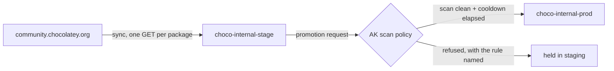

# choco-internalizer

[](https://github.com/lihongjie0209/choco-internalizer/actions/workflows/sync.yml)

Open-source Chocolatey package internalizer. It downloads installer resources,
embeds them in the `.nupkg`, rewrites supported Chocolatey helpers to local-file
helpers, and fails if external URLs remain.

The tool never executes scripts from the source package.

## Current support

- Local `.nupkg` input
- Static `$url` and `$url64bit` assignments
- PowerShell syntax-tree analysis through `tree-sitter-powershell`
- `Install-ChocolateyPackage` to `Install-ChocolateyInstallPackage`
- Download size limits
- ZIP path traversal and oversized-entry protection
- Residual external URL audit
- Pass-through verification for packages that already embed all resources

## Build and run

```bash
make test
make build
./bin/choco-internalizer internalize --input package.nupkg --output dist
```

Validate/internalize and publish in one command (already-internalized packages are
published too):

```bash
CHOCO_API_KEY=... ./bin/choco-internalizer internalize \
  --input package.nupkg \
  --output dist \
  --repository https://choco.lihongjie.cn
```

Upload the generated package:

```powershell
choco push .\dist\package.version.nupkg `
  --source https://choco.lihongjie.cn/api/v2/ `
  --api-key $env:CHOCO_API_KEY
```

Packages using computed URLs or unsupported download helpers fail closed and
must be handled by a future rule plugin or manually reviewed.

Recursively internalize dependencies and publish them before each parent package:

```bash
CHOCO_API_KEY=... ./bin/choco-internalizer sync 7zip git curl \
  --repository https://choco.lihongjie.cn
```

`packages.txt` is synchronized daily by an eight-way GitHub Actions matrix. A compatibility failure
is emitted as a workflow warning and recorded in the job summary, while the
remaining roots continue. Configure the repository secret `CHOCO_API_KEY`.

The destination repository performs idempotent `id + version` checks and keeps
only the three most recently published versions of every package, including
recursively resolved dependencies.

## This fork: Artifact Keeper, staging, and a native release gate

Upstream publishes straight into its final repository. This fork publishes into
a **staging** repository and lets Artifact Keeper's own promotion gate decide
what reaches **prod**. There is no gate logic in this repository: CI only
mirrors.



* `.github/workflows/sync.yml` mirrors the roots in `packages.txt` (and their
  dependency closure) into `choco-internal-stage`, one runner per package, so
  the community feed's per-IP limit is split across runner IPs rather than
  retried into.
* Promotion is Artifact Keeper's documented staging-to-release flow
  (`POST /api/v1/promotion/repositories/choco-internal-stage/artifacts/<id>/promote`,
  or the Promote button). The registry evaluates the policy and answers with a
  per-rule verdict; a refusal is the gate working.
* `choco-internal-prod` is `promotion_only`, so nothing can be pushed into it.

### The gate itself (configuration, not code)

One `scan_policies` row attached to the **staging** repository
(`repository_id = choco-internal-stage`) - the promotion gate resolves the
policy from the source repository, so a policy on the release repository is
never consulted:

| Field | Value | Effect |
|---|---|---|
| `max_severity` | `critical` | any critical CVE blocks the promotion (`cve-severity-threshold`); high/medium are allowed |
| `block_unscanned` | `true` | an artifact with no completed scan cannot be promoted |
| `block_on_fail` | `true` | a crashed scanner blocks, even if another engine went clean |
| `min_staging_hours` | `336` | 14-day cooldown in staging (`min-staging-time`), measured from when the mirrored version landed |

Scanning is Artifact Keeper's own: every ingested `.nupkg` is scanned
automatically (grype plus a dependency/OSV scan), which is what the policy
above reads.

Secret: `CHOCO_API_KEY` (write:artifacts) for the sync. The gate needs no
credential of its own beyond whatever promotes.
